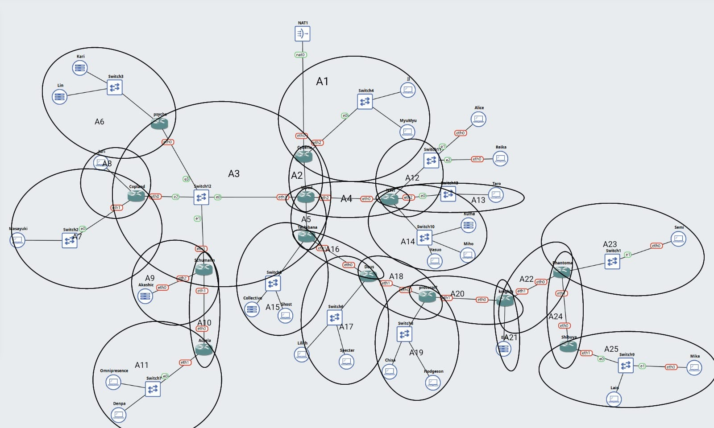
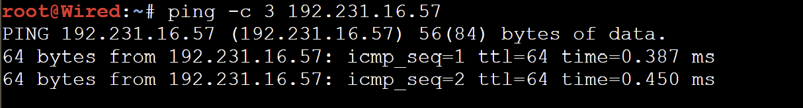
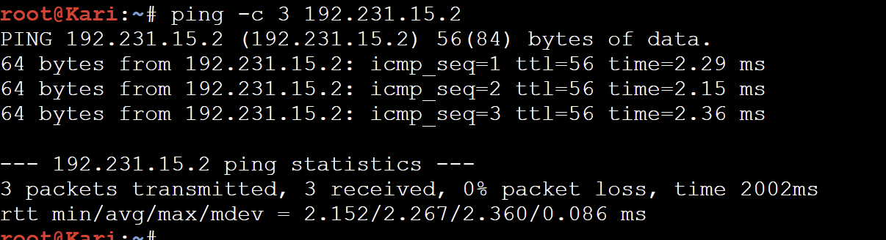
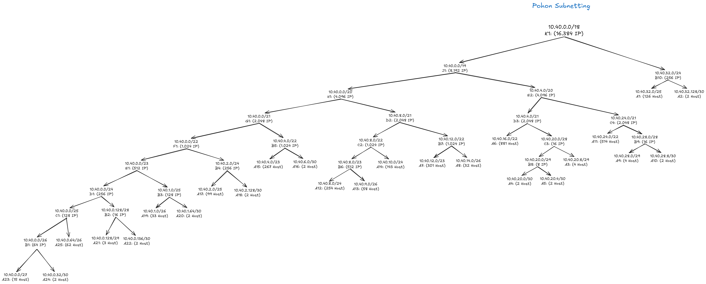
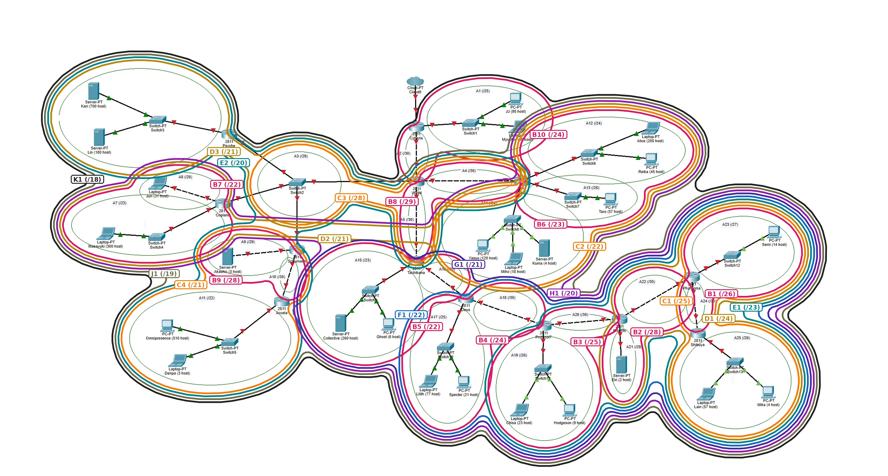
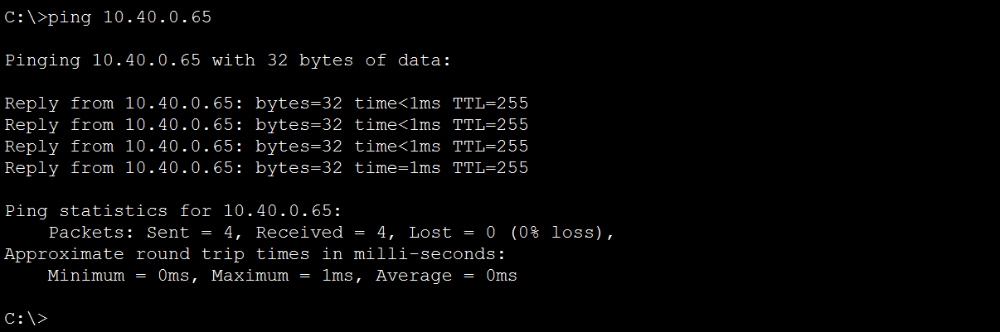
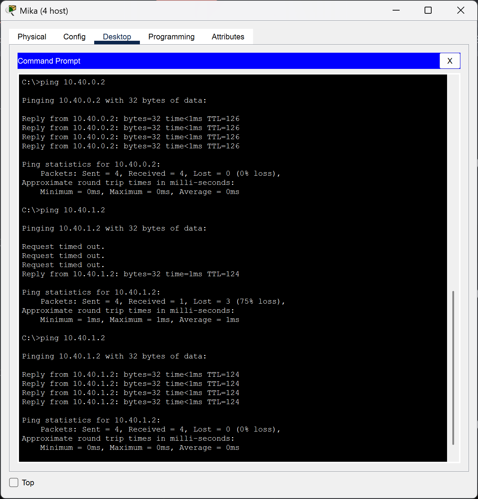
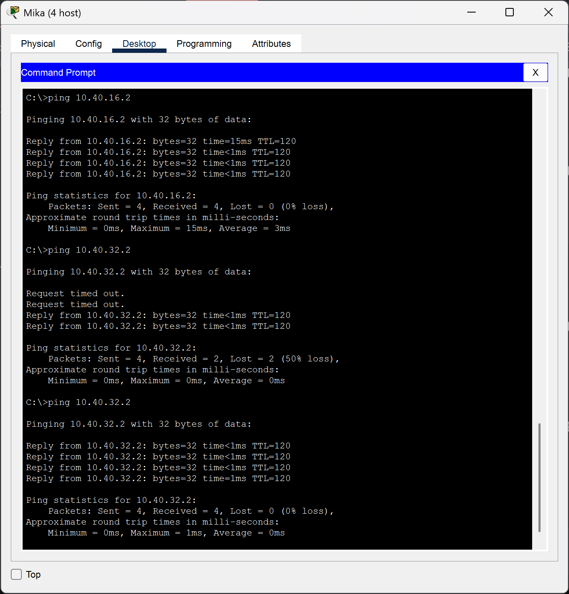
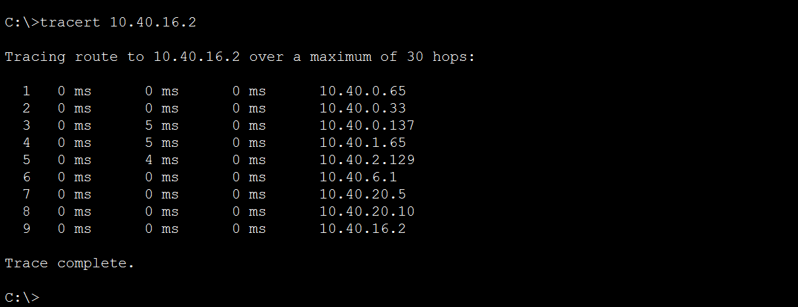

# Jarkom-Modul-4-2026-K-40

Laporan Praktikum Modul 4 Komunikasi Data dan Jaringan Komputer 2026, *The Wired Expansion*.

Bagian laporan ini membahas **Subnetting dengan metode VLSM pada GNS3**.

| Nama | NRP | Pembagian Tugas |
|---|---|---|
| Chilmi Muhammad Ulin Nuha | 003 | CPT (CIDR)|
| Wahyu Yoga Wicaksono | 103 | GNS3 (VLSM)|

## Daftar Isi

- [Pendahuluan](#pendahuluan)
- [Topologi](#topologi)
- [Routing Table](#routing-table)
- [Subnetting GNS3: Metode VLSM](#subnetting-gns3-metode-vlsm)
  - [Perhitungan VLSM](#perhitungan-vlsm)
  - [Pembagian IP](#pembagian-ip)
  - [Konfigurasi Network](#konfigurasi-network)
    - [Router](#router)
    - [Host / Server](#host--server)
  - [Konfigurasi Routing](#konfigurasi-routing)
  - [Testing](#testing)
- [Subnetting Cisco Packet Tracer: Metode CIDR](#subnetting-cisco-packet-tracer-metode-cidr)
  - [Pohon Subnetting CIDR](#pohon-subnetting-cidr)
  - [Perhitungan & Penggabungan CIDR](#perhitungan--penggabungan-cidr)
  - [Pembagian IP CIDR](#pembagian-ip-cidr)
  - [Konfigurasi Router CLI](#konfigurasi-router-cli)
  - [Konfigurasi Host / Server](#konfigurasi-host--server)
  - [Testing](#testing-cpt)

## Pendahuluan

Topologi terdiri dari 13 router dan 25 node host/server yang dihubungkan oleh switch. Seluruh node harus saling terhubung (ping) dengan pembagian IP yang efisien. Pada GNS3 digunakan metode **VLSM** (*Variable Length Subnet Mask*) dengan prefix `192.231.0.0`, sedangkan metode CIDR dikerjakan pada Cisco Packet Tracer.

Seluruh node pada GNS3 berupa Docker container. Konfigurasi IP dimasukkan melalui **Configure > Network configuration** pada tiap node, lalu skrip konfigurasi disimpan di `/root/config.sh`.

## Topologi

#### GNS3 (VLSM)



Tiap subnet ditandai dengan lingkaran hijau dan label `A1` sampai `A25`. Penomoran mengikuti urutan penelusuran topologi dari Cyberia.

## Routing Table

| Nama Subnet | Rute | Jumlah IP | Netmask |
|---|---|---|---|
| A1 | Cyberia > Switch1 > JJ, MyuMyu | 126 | /25 |
| A2 | Cyberia > Wired | 2 | /30 |
| A3 | Wired > Switch2 > Psyche, Copland, Schumann | 4 | /29 |
| A4 | Wired > Navi | 2 | /30 |
| A5 | Wired > Tachibana | 2 | /30 |
| A6 | Psyche > Switch3 > Kari, Lin | 881 | /22 |
| A7 | Copland > Switch4 > Masayuki | 301 | /23 |
| A8 | Copland > Juri | 32 | /26 |
| A9 | Schumann > Akashic | 4 | /29 |
| A10 | Schumann > Accela | 2 | /30 |
| A11 | Accela > Switch5 > Omnipresence, Denpa | 514 | /22 |
| A12 | Navi > Switch6 > Alice, Reika | 254 | /24 |
| A13 | Navi > Switch7 > Taro | 58 | /26 |
| A14 | Navi > Switch8 > Yasuo, Miho, Kuma | 143 | /24 |
| A15 | Tachibana > Switch9 > Collective, Ghost | 267 | /23 |
| A16 | Tachibana > Deus | 2 | /30 |
| A17 | Deus > Switch10 > Lilith, Specter | 99 | /25 |
| A18 | Deus > Protocol7 | 2 | /30 |
| A19 | Protocol7 > Switch11 > Chisa, Hodgeson | 33 | /26 |
| A20 | Protocol7 > Knights | 2 | /30 |
| A21 | Knights > Eiri | 3 | /29 |
| A22 | Knights > Phantoma | 2 | /30 |
| A23 | Phantoma > Switch12 > Semi | 15 | /27 |
| A24 | Phantoma > Shibuya | 2 | /30 |
| A25 | Shibuya > Switch13 > Lain, Mika | 62 | /26 |
| **Total** | | **2814** | **/19** |

Jumlah IP = jumlah host + jumlah interface router pada subnet tersebut.

## Subnetting GNS3: Metode VLSM

### Perhitungan VLSM

1. Hitung kebutuhan IP tiap subnet (host + interface router).
2. Pilih blok terkecil yang cukup: `2^n - 2 >= kebutuhan`.
3. Urutkan dari blok terbesar (`/22`) ke terkecil (`/30`).
4. Alokasikan berurutan mulai dari `192.231.0.0`. Karena diurutkan dari yang terbesar, setiap network ID otomatis sejajar (aligned) dan tidak ada alamat yang terbuang di antara subnet.
5. Gabungkan seluruh blok menjadi satu agregat: `192.231.0.0/19`.

**Info**

- Total kebutuhan IP: **2814**
- Total alamat yang dialokasikan (jumlah ukuran blok): **4188**
- Kebutuhan terhadap alamat yang dialokasikan: 2814 dari 4188 (67.2%)
- Sisa di dalam blok (tidak terpakai tiap subnet): 1374 (32.8%)
- Agregat `192.231.0.0/19` berisi 8192 alamat, 4188 terpakai (51.1%). Rentang `192.231.16.92` sampai `192.231.31.255` masih kosong.

### Pembagian IP

Diurutkan dari netmask terbesar sesuai aturan VLSM.

| Subnet | Network ID | Netmask | Broadcast | Range IP |
|---|---|---|---|---|
| A6 | 192.231.0.0 | 255.255.252.0 | 192.231.3.255 | 192.231.0.1 - 192.231.3.254 |
| A11 | 192.231.4.0 | 255.255.252.0 | 192.231.7.255 | 192.231.4.1 - 192.231.7.254 |
| A7 | 192.231.8.0 | 255.255.254.0 | 192.231.9.255 | 192.231.8.1 - 192.231.9.254 |
| A15 | 192.231.10.0 | 255.255.254.0 | 192.231.11.255 | 192.231.10.1 - 192.231.11.254 |
| A12 | 192.231.12.0 | 255.255.255.0 | 192.231.12.255 | 192.231.12.1 - 192.231.12.254 |
| A14 | 192.231.13.0 | 255.255.255.0 | 192.231.13.255 | 192.231.13.1 - 192.231.13.254 |
| A1 | 192.231.14.0 | 255.255.255.128 | 192.231.14.127 | 192.231.14.1 - 192.231.14.126 |
| A17 | 192.231.14.128 | 255.255.255.128 | 192.231.14.255 | 192.231.14.129 - 192.231.14.254 |
| A25 | 192.231.15.0 | 255.255.255.192 | 192.231.15.63 | 192.231.15.1 - 192.231.15.62 |
| A13 | 192.231.15.64 | 255.255.255.192 | 192.231.15.127 | 192.231.15.65 - 192.231.15.126 |
| A19 | 192.231.15.128 | 255.255.255.192 | 192.231.15.191 | 192.231.15.129 - 192.231.15.190 |
| A8 | 192.231.15.192 | 255.255.255.192 | 192.231.15.255 | 192.231.15.193 - 192.231.15.254 |
| A23 | 192.231.16.0 | 255.255.255.224 | 192.231.16.31 | 192.231.16.1 - 192.231.16.30 |
| A3 | 192.231.16.32 | 255.255.255.248 | 192.231.16.39 | 192.231.16.33 - 192.231.16.38 |
| A9 | 192.231.16.40 | 255.255.255.248 | 192.231.16.47 | 192.231.16.41 - 192.231.16.46 |
| A21 | 192.231.16.48 | 255.255.255.248 | 192.231.16.55 | 192.231.16.49 - 192.231.16.54 |
| A2 | 192.231.16.56 | 255.255.255.252 | 192.231.16.59 | 192.231.16.57 - 192.231.16.58 |
| A4 | 192.231.16.60 | 255.255.255.252 | 192.231.16.63 | 192.231.16.61 - 192.231.16.62 |
| A5 | 192.231.16.64 | 255.255.255.252 | 192.231.16.67 | 192.231.16.65 - 192.231.16.66 |
| A10 | 192.231.16.68 | 255.255.255.252 | 192.231.16.71 | 192.231.16.69 - 192.231.16.70 |
| A16 | 192.231.16.72 | 255.255.255.252 | 192.231.16.75 | 192.231.16.73 - 192.231.16.74 |
| A18 | 192.231.16.76 | 255.255.255.252 | 192.231.16.79 | 192.231.16.77 - 192.231.16.78 |
| A20 | 192.231.16.80 | 255.255.255.252 | 192.231.16.83 | 192.231.16.81 - 192.231.16.82 |
| A22 | 192.231.16.84 | 255.255.255.252 | 192.231.16.87 | 192.231.16.85 - 192.231.16.86 |
| A24 | 192.231.16.88 | 255.255.255.252 | 192.231.16.91 | 192.231.16.89 - 192.231.16.90 |

### Konfigurasi Network

Cara memasukkan: klik kanan node > **Configure** > **Network configuration**, tempel isinya, **Save**, lalu **Stop** dan **Start** node. Skrip `config.sh` dibuat lewat **Console** node (klik kanan > Console), lalu dijalankan dengan `bash /root/config.sh`. Skrip memakai `ip ... replace` sehingga aman dijalankan berulang.

#### Router

**Cyberia**

```bash
cat > /root/config.sh <<'EOF'
#!/bin/bash
ip addr replace 192.231.16.57/30 dev eth1
ip addr replace 192.231.14.1/25 dev eth2
sysctl -w net.ipv4.ip_forward=1
iptables -t nat -C POSTROUTING -o eth0 -j MASQUERADE 2>/dev/null || iptables -t nat -A POSTROUTING -o eth0 -j MASQUERADE
ip route replace 192.231.0.0/19 via 192.231.16.58 dev eth1
EOF
```

**Wired**

```bash
cat > /root/config.sh <<'EOF'
#!/bin/bash
ip addr replace 192.231.16.58/30 dev eth0
ip addr replace 192.231.16.65/30 dev eth1
ip addr replace 192.231.16.61/30 dev eth2
ip addr replace 192.231.16.33/29 dev eth3
sysctl -w net.ipv4.ip_forward=1
ip route replace default via 192.231.16.57
ip route replace 192.231.10.0/23 via 192.231.16.66
ip route replace 192.231.14.128/25 via 192.231.16.66
ip route replace 192.231.15.0/26 via 192.231.16.66
ip route replace 192.231.15.128/26 via 192.231.16.66
ip route replace 192.231.16.0/27 via 192.231.16.66
ip route replace 192.231.16.48/29 via 192.231.16.66
ip route replace 192.231.16.72/29 via 192.231.16.66
ip route replace 192.231.16.80/28 via 192.231.16.66
ip route replace 192.231.12.0/23 via 192.231.16.62
ip route replace 192.231.15.64/26 via 192.231.16.62
ip route replace 192.231.0.0/22 via 192.231.16.34
ip route replace 192.231.8.0/23 via 192.231.16.35
ip route replace 192.231.15.192/26 via 192.231.16.35
ip route replace 192.231.16.40/29 via 192.231.16.36
ip route replace 192.231.16.68/30 via 192.231.16.36
ip route replace 192.231.4.0/22 via 192.231.16.36
EOF
```

**Psyche**

```bash
cat > /root/config.sh <<'EOF'
#!/bin/bash
ip addr replace 192.231.16.34/29 dev eth0
ip addr replace 192.231.0.1/22 dev eth1
sysctl -w net.ipv4.ip_forward=1
ip route replace default via 192.231.16.33
EOF
```

**Copland**

```bash
cat > /root/config.sh <<'EOF'
#!/bin/bash
ip addr replace 192.231.16.35/29 dev eth0
ip addr replace 192.231.8.1/23 dev eth1
ip addr replace 192.231.15.193/26 dev eth2
sysctl -w net.ipv4.ip_forward=1
ip route replace default via 192.231.16.33
EOF
```

**Schumann**

```bash
cat > /root/config.sh <<'EOF'
#!/bin/bash
ip addr replace 192.231.16.36/29 dev eth0
ip addr replace 192.231.16.69/30 dev eth1
ip addr replace 192.231.16.41/29 dev eth2
sysctl -w net.ipv4.ip_forward=1
ip route replace default via 192.231.16.33
ip route replace 192.231.4.0/22 via 192.231.16.70
EOF
```

**Accela**

```bash
cat > /root/config.sh <<'EOF'
#!/bin/bash
ip addr replace 192.231.16.70/30 dev eth0
ip addr replace 192.231.4.1/22 dev eth1
sysctl -w net.ipv4.ip_forward=1
ip route replace default via 192.231.16.69
EOF
```

**Navi**

```bash
cat > /root/config.sh <<'EOF'
#!/bin/bash
ip addr replace 192.231.16.62/30 dev eth0
ip addr replace 192.231.12.1/24 dev eth1
ip addr replace 192.231.15.65/26 dev eth2
ip addr replace 192.231.13.1/24 dev eth3
sysctl -w net.ipv4.ip_forward=1
ip route replace default via 192.231.16.61
EOF
```

**Tachibana**

```bash
cat > /root/config.sh <<'EOF'
#!/bin/bash
ip addr replace 192.231.16.66/30 dev eth0
ip addr replace 192.231.16.73/30 dev eth1
ip addr replace 192.231.10.1/23 dev eth2
sysctl -w net.ipv4.ip_forward=1
ip route replace default via 192.231.16.65
ip route replace 192.231.14.128/25 via 192.231.16.74
ip route replace 192.231.15.0/26 via 192.231.16.74
ip route replace 192.231.15.128/26 via 192.231.16.74
ip route replace 192.231.16.0/27 via 192.231.16.74
ip route replace 192.231.16.48/29 via 192.231.16.74
ip route replace 192.231.16.76/30 via 192.231.16.74
ip route replace 192.231.16.80/28 via 192.231.16.74
EOF
```

**Deus**

```bash
cat > /root/config.sh <<'EOF'
#!/bin/bash
ip addr replace 192.231.16.74/30 dev eth0
ip addr replace 192.231.16.77/30 dev eth1
ip addr replace 192.231.14.129/25 dev eth2
sysctl -w net.ipv4.ip_forward=1
ip route replace default via 192.231.16.73
ip route replace 192.231.15.0/26 via 192.231.16.78
ip route replace 192.231.15.128/26 via 192.231.16.78
ip route replace 192.231.16.0/27 via 192.231.16.78
ip route replace 192.231.16.48/29 via 192.231.16.78
ip route replace 192.231.16.80/28 via 192.231.16.78
EOF
```

**protocol7**

```bash
cat > /root/config.sh <<'EOF'
#!/bin/bash
ip addr replace 192.231.16.78/30 dev eth0
ip addr replace 192.231.16.81/30 dev eth1
ip addr replace 192.231.15.129/26 dev eth2
sysctl -w net.ipv4.ip_forward=1
ip route replace default via 192.231.16.77
ip route replace 192.231.15.0/26 via 192.231.16.82
ip route replace 192.231.16.0/27 via 192.231.16.82
ip route replace 192.231.16.48/29 via 192.231.16.82
ip route replace 192.231.16.84/30 via 192.231.16.82
ip route replace 192.231.16.88/30 via 192.231.16.82
EOF
```

**knights**

```bash
cat > /root/config.sh <<'EOF'
#!/bin/bash
ip addr replace 192.231.16.82/30 dev eth0
ip addr replace 192.231.16.85/30 dev eth1
ip addr replace 192.231.16.49/29 dev eth2
sysctl -w net.ipv4.ip_forward=1
ip route replace default via 192.231.16.81
ip route replace 192.231.15.0/26 via 192.231.16.86
ip route replace 192.231.16.0/27 via 192.231.16.86
ip route replace 192.231.16.88/30 via 192.231.16.86
EOF
```

**Phantoma**

```bash
cat > /root/config.sh <<'EOF'
#!/bin/bash
ip addr replace 192.231.16.86/30 dev eth0
ip addr replace 192.231.16.89/30 dev eth1
ip addr replace 192.231.16.1/27 dev eth2
sysctl -w net.ipv4.ip_forward=1
ip route replace default via 192.231.16.85
ip route replace 192.231.15.0/26 via 192.231.16.90
EOF
```

**Shibuya**

```bash
cat > /root/config.sh <<'EOF'
#!/bin/bash
ip addr replace 192.231.16.90/30 dev eth0
ip addr replace 192.231.15.1/26 dev eth1
sysctl -w net.ipv4.ip_forward=1
ip route replace default via 192.231.16.89
EOF
```

Pada Cyberia, `eth0` mengambil IP lewat DHCP dari NAT (192.168.122.x) sehingga tidak diatur manual. Baris `iptables ... MASQUERADE` memberi akses keluar untuk seluruh subnet, dan rute `192.231.0.0/19 via 192.231.16.58` mengarahkan semua jaringan internal ke Wired.

#### Host / Server

**Kari**

```
auto eth0
iface eth0 inet static
    address 192.231.0.2
    netmask 255.255.252.0
    gateway 192.231.0.1
```

Skrip: `ip addr replace 192.231.0.2/22 dev eth0` dan `ip route replace default via 192.231.0.1`

**Lin**

```
auto eth0
iface eth0 inet static
    address 192.231.0.3
    netmask 255.255.252.0
    gateway 192.231.0.1
```

Skrip: `ip addr replace 192.231.0.3/22 dev eth0` dan `ip route replace default via 192.231.0.1`

**Masayuki**

```
auto eth0
iface eth0 inet static
    address 192.231.8.2
    netmask 255.255.254.0
    gateway 192.231.8.1
```

Skrip: `ip addr replace 192.231.8.2/23 dev eth0` dan `ip route replace default via 192.231.8.1`

**Juri**

```
auto eth0
iface eth0 inet static
    address 192.231.15.194
    netmask 255.255.255.192
    gateway 192.231.15.193
```

Skrip: `ip addr replace 192.231.15.194/26 dev eth0` dan `ip route replace default via 192.231.15.193`

**Akashic**

```
auto eth0
iface eth0 inet static
    address 192.231.16.42
    netmask 255.255.255.248
    gateway 192.231.16.41
```

Skrip: `ip addr replace 192.231.16.42/29 dev eth0` dan `ip route replace default via 192.231.16.41`

**Omnipresence**

```
auto eth0
iface eth0 inet static
    address 192.231.4.2
    netmask 255.255.252.0
    gateway 192.231.4.1
```

Skrip: `ip addr replace 192.231.4.2/22 dev eth0` dan `ip route replace default via 192.231.4.1`

**Denpa**

```
auto eth0
iface eth0 inet static
    address 192.231.4.3
    netmask 255.255.252.0
    gateway 192.231.4.1
```

Skrip: `ip addr replace 192.231.4.3/22 dev eth0` dan `ip route replace default via 192.231.4.1`

**Alice**

```
auto eth0
iface eth0 inet static
    address 192.231.12.2
    netmask 255.255.255.0
    gateway 192.231.12.1
```

Skrip: `ip addr replace 192.231.12.2/24 dev eth0` dan `ip route replace default via 192.231.12.1`

**Reika**

```
auto eth0
iface eth0 inet static
    address 192.231.12.3
    netmask 255.255.255.0
    gateway 192.231.12.1
```

Skrip: `ip addr replace 192.231.12.3/24 dev eth0` dan `ip route replace default via 192.231.12.1`

**Taro**

```
auto eth0
iface eth0 inet static
    address 192.231.15.66
    netmask 255.255.255.192
    gateway 192.231.15.65
```

Skrip: `ip addr replace 192.231.15.66/26 dev eth0` dan `ip route replace default via 192.231.15.65`

**Yasuo**

```
auto eth0
iface eth0 inet static
    address 192.231.13.2
    netmask 255.255.255.0
    gateway 192.231.13.1
```

Skrip: `ip addr replace 192.231.13.2/24 dev eth0` dan `ip route replace default via 192.231.13.1`

**Miho**

```
auto eth0
iface eth0 inet static
    address 192.231.13.3
    netmask 255.255.255.0
    gateway 192.231.13.1
```

Skrip: `ip addr replace 192.231.13.3/24 dev eth0` dan `ip route replace default via 192.231.13.1`

**Kuma**

```
auto eth0
iface eth0 inet static
    address 192.231.13.4
    netmask 255.255.255.0
    gateway 192.231.13.1
```

Skrip: `ip addr replace 192.231.13.4/24 dev eth0` dan `ip route replace default via 192.231.13.1`

**Collective**

```
auto eth0
iface eth0 inet static
    address 192.231.10.2
    netmask 255.255.254.0
    gateway 192.231.10.1
```

Skrip: `ip addr replace 192.231.10.2/23 dev eth0` dan `ip route replace default via 192.231.10.1`

**Ghost**

```
auto eth0
iface eth0 inet static
    address 192.231.10.3
    netmask 255.255.254.0
    gateway 192.231.10.1
```

Skrip: `ip addr replace 192.231.10.3/23 dev eth0` dan `ip route replace default via 192.231.10.1`

**Lilith**

```
auto eth0
iface eth0 inet static
    address 192.231.14.130
    netmask 255.255.255.128
    gateway 192.231.14.129
```

Skrip: `ip addr replace 192.231.14.130/25 dev eth0` dan `ip route replace default via 192.231.14.129`

**Specter**

```
auto eth0
iface eth0 inet static
    address 192.231.14.131
    netmask 255.255.255.128
    gateway 192.231.14.129
```

Skrip: `ip addr replace 192.231.14.131/25 dev eth0` dan `ip route replace default via 192.231.14.129`

**Chisa**

```
auto eth0
iface eth0 inet static
    address 192.231.15.130
    netmask 255.255.255.192
    gateway 192.231.15.129
```

Skrip: `ip addr replace 192.231.15.130/26 dev eth0` dan `ip route replace default via 192.231.15.129`

**Hodgeson**

```
auto eth0
iface eth0 inet static
    address 192.231.15.131
    netmask 255.255.255.192
    gateway 192.231.15.129
```

Skrip: `ip addr replace 192.231.15.131/26 dev eth0` dan `ip route replace default via 192.231.15.129`

**Eiri**

```
auto eth0
iface eth0 inet static
    address 192.231.16.50
    netmask 255.255.255.248
    gateway 192.231.16.49
```

Skrip: `ip addr replace 192.231.16.50/29 dev eth0` dan `ip route replace default via 192.231.16.49`

**Semi**

```
auto eth0
iface eth0 inet static
    address 192.231.16.2
    netmask 255.255.255.224
    gateway 192.231.16.1
```

Skrip: `ip addr replace 192.231.16.2/27 dev eth0` dan `ip route replace default via 192.231.16.1`

**Lain**

```
auto eth0
iface eth0 inet static
    address 192.231.15.2
    netmask 255.255.255.192
    gateway 192.231.15.1
```

Skrip: `ip addr replace 192.231.15.2/26 dev eth0` dan `ip route replace default via 192.231.15.1`

**Mika**

```
auto eth0
iface eth0 inet static
    address 192.231.15.3
    netmask 255.255.255.192
    gateway 192.231.15.1
```

Skrip: `ip addr replace 192.231.15.3/26 dev eth0` dan `ip route replace default via 192.231.15.1`

**JJ**

```
auto eth0
iface eth0 inet static
    address 192.231.14.2
    netmask 255.255.255.128
    gateway 192.231.14.1
```

Skrip: `ip addr replace 192.231.14.2/25 dev eth0` dan `ip route replace default via 192.231.14.1`

**MyuMyu**

```
auto eth0
iface eth0 inet static
    address 192.231.14.3
    netmask 255.255.255.128
    gateway 192.231.14.1
```

Skrip: `ip addr replace 192.231.14.3/25 dev eth0` dan `ip route replace default via 192.231.14.1`


### Testing





## Subnetting Cisco Packet Tracer: Metode CIDR

Pada Cisco Packet Tracer (CPT), subnetting dilakukan menggunakan metode **CIDR** (*Classless Inter-Domain Routing*) dengan skema penggabungan rute *Bottom-Up Supernetting* berbasis prefix privat `10.40.0.0`.

### Pohon Subnetting CIDR

Pohon subnetting berikut menggambarkan alur penggabungan hirarkis dari subnet dasar terbawah (`A1` s.d. `A25`) hingga membentuk supernet puncak `K1` (`10.40.0.0/18`).



### Perhitungan & Penggabungan CIDR

1. **Prinsip Bottom-Up Supernetting:** Penggabungan dilakukan mulai dari pasangan subnet terbawah yang bertetangga pada topologi fisik hingga membentuk kelompok penggabungan (B1–B10, C1–C4, D1–D3, E1–E2, F1, G1, H1, J1, dan K1).
2. **Binary Boundary Alignment:** Setiap alamat network ID penggabungan diwajibkan berada pada batas kelipatan bit biner (*binary boundary*) sesuai ukuran prefix-nya.
3. **Penentuan Prefix Supernet Puncak (K1):**
   - Total kebutuhan IP murni seluruh subnet = **4.188 IP**.
   - Akibat penyesuaian *binary boundary* antar-cabang, rentang IP terpakai membentang dari `10.40.0.0` hingga `10.40.32.131` (total rentang **8.324 IP**).
   - Karena blok `/19` (8.192 IP) tidak mencukupi rentang 8.324 IP, maka supernet akhir yang menampung seluruh hirarki jaringan berada pada prefix **`/18`** (`10.40.0.0/18` dengan kapasitas 16.384 IP).
4. **Efisiensi Routing:** Meskipun terdapat celah pengalokasian IP untuk menjaga kerapian *binary boundary*, metode ini menghasilkan tabel routing yang sangat efisien karena setiap router hanya membutuhkan 1 baris rute ringkas (*summary route*) untuk menjangkau seluruh subnet di bawahnya.



### Pembagian IP CIDR

Berikut adalah hasil alokasi IP CIDR berdasarkan skema Bottom-Up Supernetting:

| Subnet | Network ID | Netmask | Broadcast | Range IP |
|---|---|---|---|---|
| A23 | 10.40.0.0 | 255.255.255.224 | 10.40.0.31 | 10.40.0.1 - 10.40.0.30 |
| A24 | 10.40.0.32 | 255.255.255.252 | 10.40.0.35 | 10.40.0.33 - 10.40.0.34 |
| A25 | 10.40.0.64 | 255.255.255.192 | 10.40.0.127 | 10.40.0.65 - 10.40.0.126 |
| A21 | 10.40.0.128 | 255.255.255.248 | 10.40.0.135 | 10.40.0.129 - 10.40.0.134 |
| A22 | 10.40.0.136 | 255.255.255.252 | 10.40.0.139 | 10.40.0.137 - 10.40.0.138 |
| A19 | 10.40.1.0 | 255.255.255.192 | 10.40.1.63 | 10.40.1.1 - 10.40.1.62 |
| A20 | 10.40.1.64 | 255.255.255.252 | 10.40.1.67 | 10.40.1.65 - 10.40.1.66 |
| A17 | 10.40.2.0 | 255.255.255.128 | 10.40.2.127 | 10.40.2.1 - 10.40.2.126 |
| A18 | 10.40.2.128 | 255.255.255.252 | 10.40.2.131 | 10.40.2.129 - 10.40.2.130 |
| A15 | 10.40.4.0 | 255.255.254.0 | 10.40.5.255 | 10.40.4.1 - 10.40.5.254 |
| A16 | 10.40.6.0 | 255.255.255.252 | 10.40.6.3 | 10.40.6.1 - 10.40.6.2 |
| A12 | 10.40.8.0 | 255.255.255.0 | 10.40.8.255 | 10.40.8.1 - 10.40.8.254 |
| A13 | 10.40.9.0 | 255.255.255.192 | 10.40.9.63 | 10.40.9.1 - 10.40.9.62 |
| A14 | 10.40.10.0 | 255.255.255.0 | 10.40.10.255 | 10.40.10.1 - 10.40.10.254 |
| A7 | 10.40.12.0 | 255.255.254.0 | 10.40.13.255 | 10.40.12.1 - 10.40.13.254 |
| A8 | 10.40.14.0 | 255.255.255.192 | 10.40.14.63 | 10.40.14.1 - 10.40.14.62 |
| A6 | 10.40.16.0 | 255.255.252.0 | 10.40.19.255 | 10.40.16.1 - 10.40.19.254 |
| A4 | 10.40.20.0 | 255.255.255.252 | 10.40.20.3 | 10.40.20.1 - 10.40.20.2 |
| A5 | 10.40.20.4 | 255.255.255.252 | 10.40.20.7 | 10.40.20.5 - 10.40.20.6 |
| A3 | 10.40.20.8 | 255.255.255.248 | 10.40.20.15 | 10.40.20.9 - 10.40.20.14 |
| A11 | 10.40.24.0 | 255.255.252.0 | 10.40.27.255 | 10.40.24.1 - 10.40.27.254 |
| A9 | 10.40.28.0 | 255.255.255.248 | 10.40.28.7 | 10.40.28.1 - 10.40.28.6 |
| A10 | 10.40.28.8 | 255.255.255.252 | 10.40.28.11 | 10.40.28.9 - 10.40.28.10 |
| A1 | 10.40.32.0 | 255.255.255.128 | 10.40.32.127 | 10.40.32.1 - 10.40.32.126 |
| A2 | 10.40.32.128 | 255.255.255.252 | 10.40.32.131 | 10.40.32.129 - 10.40.32.130 |

### Konfigurasi Router CLI

Seluruh konfigurasi interface dan rute statik (*static route*) dimasukkan melalui CLI masing-masing router.

<details>
<summary><b>Klik untuk membuka Skrip Konfigurasi 13 Router</b></summary>

```text
! 1. Cyberia
enable
configure terminal
hostname Cyberia
interface fa0/1
 ip address 10.40.32.129 255.255.255.252
 no shutdown
exit
interface fa1/0
 ip address 10.40.32.1 255.255.255.128
 no shutdown
exit
ip route 10.40.0.0 255.255.224.0 10.40.32.130
exit
write

! 2. Wired
enable
configure terminal
hostname Wired
interface fa0/0
 ip address 10.40.32.130 255.255.255.252
 no shutdown
exit
interface fa0/1
 ip address 10.40.20.9 255.255.255.248
 no shutdown
exit
interface fa1/0
 ip address 10.40.20.1 255.255.255.252
 no shutdown
exit
interface fa1/1
 ip address 10.40.20.5 255.255.255.252
 no shutdown
exit
ip route 10.40.16.0 255.255.252.0 10.40.20.10
ip route 10.40.12.0 255.255.252.0 10.40.20.11
ip route 10.40.24.0 255.255.248.0 10.40.20.12
ip route 10.40.8.0 255.255.252.0 10.40.20.2
ip route 10.40.0.0 255.255.248.0 10.40.20.6
ip route 0.0.0.0 0.0.0.0 10.40.32.129
exit
write

! 3. Psyche
enable
configure terminal
hostname Psyche
interface fa0/0
 ip address 10.40.20.10 255.255.255.248
 no shutdown
exit
interface fa0/1
 ip address 10.40.16.1 255.255.252.0
 no shutdown
exit
ip route 0.0.0.0 0.0.0.0 10.40.20.9
exit
write

! 4. Copland
enable
configure terminal
hostname Copland
interface fa0/0
 ip address 10.40.20.11 255.255.255.248
 no shutdown
exit
interface fa0/1
 ip address 10.40.12.1 255.255.254.0
 no shutdown
exit
interface fa1/0
 ip address 10.40.14.1 255.255.255.192
 no shutdown
exit
ip route 0.0.0.0 0.0.0.0 10.40.20.9
exit
write

! 5. Schumann
enable
configure terminal
hostname Schumann
interface fa0/0
 ip address 10.40.20.12 255.255.255.248
 no shutdown
exit
interface fa0/1
 ip address 10.40.28.1 255.255.255.248
 no shutdown
exit
interface fa1/0
 ip address 10.40.28.9 255.255.255.252
 no shutdown
exit
ip route 10.40.24.0 255.255.252.0 10.40.28.10
ip route 0.0.0.0 0.0.0.0 10.40.20.9
exit
write

! 6. Accela
enable
configure terminal
hostname Accela
interface fa0/0
 ip address 10.40.28.10 255.255.255.252
 no shutdown
exit
interface fa0/1
 ip address 10.40.24.1 255.255.252.0
 no shutdown
exit
ip route 0.0.0.0 0.0.0.0 10.40.28.9
exit
write

! 7. Navi
enable
configure terminal
hostname Navi
interface fa0/0
 ip address 10.40.20.2 255.255.255.252
 no shutdown
exit
interface fa0/1
 ip address 10.40.8.1 255.255.255.0
 no shutdown
exit
interface fa1/0
 ip address 10.40.9.1 255.255.255.192
 no shutdown
exit
interface fa1/1
 ip address 10.40.10.1 255.255.255.0
 no shutdown
exit
ip route 0.0.0.0 0.0.0.0 10.40.20.1
exit
write

! 8. Tachibana
enable
configure terminal
hostname Tachibana
interface fa0/0
 ip address 10.40.20.6 255.255.255.252
 no shutdown
exit
interface fa0/1
 ip address 10.40.4.1 255.255.254.0
 no shutdown
exit
interface fa1/0
 ip address 10.40.6.1 255.255.255.252
 no shutdown
exit
ip route 10.40.0.0 255.255.252.0 10.40.6.2
ip route 0.0.0.0 0.0.0.0 10.40.20.5
exit
write

! 9. Deus
enable
configure terminal
hostname Deus
interface fa0/0
 ip address 10.40.6.2 255.255.255.252
 no shutdown
exit
interface fa0/1
 ip address 10.40.2.1 255.255.255.128
 no shutdown
exit
interface fa1/0
 ip address 10.40.2.129 255.255.255.252
 no shutdown
exit
ip route 10.40.0.0 255.255.254.0 10.40.2.130
ip route 0.0.0.0 0.0.0.0 10.40.6.1
exit
write

! 10. Protocol7
enable
configure terminal
hostname Protocol7
interface fa0/0
 ip address 10.40.2.130 255.255.255.252
 no shutdown
exit
interface fa0/1
 ip address 10.40.1.1 255.255.255.192
 no shutdown
exit
interface fa1/0
 ip address 10.40.1.65 255.255.255.252
 no shutdown
exit
ip route 10.40.0.0 255.255.255.0 10.40.1.66
ip route 0.0.0.0 0.0.0.0 10.40.2.129
exit
write

! 11. Knights
enable
configure terminal
hostname Knights
interface fa0/0
 ip address 10.40.1.66 255.255.255.252
 no shutdown
exit
interface fa0/1
 ip address 10.40.0.129 255.255.255.248
 no shutdown
exit
interface fa1/0
 ip address 10.40.0.137 255.255.255.252
 no shutdown
exit
ip route 10.40.0.0 255.255.255.128 10.40.0.138
ip route 0.0.0.0 0.0.0.0 10.40.1.65
exit
write

! 12. Phantoma
enable
configure terminal
hostname Phantoma
interface fa0/0
 ip address 10.40.0.138 255.255.255.252
 no shutdown
exit
interface fa0/1
 ip address 10.40.0.1 255.255.255.224
 no shutdown
exit
interface fa1/0
 ip address 10.40.0.33 255.255.255.252
 no shutdown
exit
ip route 10.40.0.64 255.255.255.192 10.40.0.34
ip route 0.0.0.0 0.0.0.0 10.40.0.137
exit
write

! 13. Shibuya
enable
configure terminal
hostname Shibuya
interface fa0/0
 ip address 10.40.0.34 255.255.255.252
 no shutdown
exit
interface fa0/1
 ip address 10.40.0.65 255.255.255.192
 no shutdown
exit
ip route 0.0.0.0 0.0.0.0 10.40.0.33
exit
write

#### Host / Server

Konfigurasi IP pada Cisco Packet Tracer dilakukan secara statis melalui GUI masing-masing node pada menu **Desktop > IP Configuration (Static)**:

| Perangkat (Node) | Subnet | IP Address | Subnet Mask | Default Gateway |
| :--- | :---: | :--- | :--- | :--- |
| **PC JJ** | A1 | `10.40.32.2` | `255.255.255.128` | `10.40.32.1` |
| **Laptop MyuMyu** | A1 | `10.40.32.3` | `255.255.255.128` | `10.40.32.1` |
| **Server Kari** | A6 | `10.40.16.2` | `255.255.252.0` | `10.40.16.1` |
| **Server Lin** | A6 | `10.40.16.3` | `255.255.252.0` | `10.40.16.1` |
| **Laptop Masayuki** | A7 | `10.40.12.2` | `255.255.254.0` | `10.40.12.1` |
| **Laptop Juri** | A8 | `10.40.14.2` | `255.255.255.192` | `10.40.14.1` |
| **Server Akashic** | A9 | `10.40.28.2` | `255.255.255.248` | `10.40.28.1` |
| **PC Omnipresence** | A11 | `10.40.24.2` | `255.255.252.0` | `10.40.24.1` |
| **Laptop Denpa** | A11 | `10.40.24.3` | `255.255.252.0` | `10.40.24.1` |
| **Laptop Alice** | A12 | `10.40.8.2` | `255.255.255.0` | `10.40.8.1` |
| **PC Reika** | A12 | `10.40.8.3` | `255.255.255.0` | `10.40.8.1` |
| **PC Taro** | A13 | `10.40.9.2` | `255.255.255.192` | `10.40.9.1` |
| **PC Yasuo** | A14 | `10.40.10.2` | `255.255.255.0` | `10.40.10.1` |
| **Laptop Miho** | A14 | `10.40.10.3` | `255.255.255.0` | `10.40.10.1` |
| **Server Kuma** | A14 | `10.40.10.4` | `255.255.255.0` | `10.40.10.1` |
| **Server Collective** | A15 | `10.40.4.2` | `255.255.254.0` | `10.40.4.1` |
| **PC Ghost** | A15 | `10.40.4.3` | `255.255.254.0` | `10.40.4.1` |
| **Laptop Lilith** | A17 | `10.40.2.2` | `255.255.255.128` | `10.40.2.1` |
| **PC Specter** | A17 | `10.40.2.3` | `255.255.255.128` | `10.40.2.1` |
| **Laptop Chisa** | A19 | `10.40.1.2` | `255.255.255.192` | `10.40.1.1` |
| **PC Hodgeson** | A19 | `10.40.1.3` | `255.255.255.192` | `10.40.1.1` |
| **Server Eiri** | A21 | `10.40.0.130` | `255.255.255.248` | `10.40.0.129` |
| **PC Semi** | A23 | `10.40.0.2` | `255.255.255.224` | `10.40.0.1` |
| **Laptop Lain** | A25 | `10.40.0.66` | `255.255.255.192` | `10.40.0.65` |
| **PC Mika** | A25 | `10.40.0.67` | `255.255.255.192` | `10.40.0.65` |

### Testing (CPT)

Pengujian konektivitas pada Cisco Packet Tracer dilakukan melalui **Command Prompt** pada host untuk memverifikasi keterhubungan jaringan dari lokal hingga lintas cabang:

1. **Pengujian Ping Gateway Lokal**
   Pengujian `ping` dari **PC Mika** (`10.40.0.67`) ke Default Gateway-nya di Subnet A25 (`10.40.0.65` - Router Shibuya).

   

2. **Pengujian Ping Lintas Subnet Dekat & Menengah**
   Pengujian `ping` dari **PC Mika** (`10.40.0.67`) ke **PC Semi** di Subnet A23 (`10.40.0.2`) dan **Laptop Chisa** di Subnet A19 (`10.40.1.2`).

   

3. **Pengujian Ping End-to-End Lintas Cabang**
   Pengujian `ping` dari **PC Mika** (`10.40.0.67`) ke **Server Kari** di Subnet A6 (`10.40.16.2`) dan **PC JJ** di Subnet A1 (`10.40.32.2`).

   

4. **Pengujian Traceroute Verifikasi Jalur Routing**
   Pengujian `tracert 10.40.16.2` dari **PC Mika** (Subnet A25) ke **Server Kari** (Subnet A6) untuk membuktikan bahwa perambatan paket melompati 9 router secara hirarkis sesuai dengan ringkasan rute CIDR.

   
